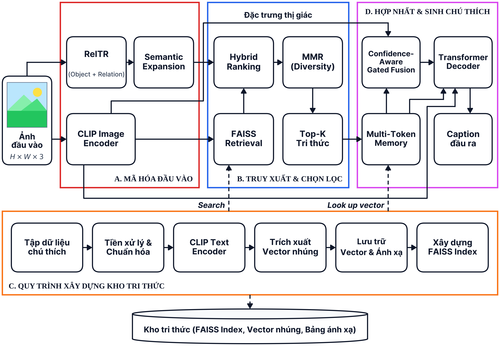

# Khóa Luận Tốt Nghiệp: Phương Pháp Sinh Chú Thích Ảnh Tự Động Dựa Trên Tăng Cường Truy Hồi Tri Thức Ngữ Nghĩa Và Đồ Thị Cảnh

> **Scene-Graph & Diverse Gated Multi-Token Retrieval-Augmented Generation for Image Captioning (SG-DGM-RAG / Full Proposed RAG)**  
> *Đồ án Khóa Luận Tốt Nghiệp Ngành Công Nghệ Thông Tin (Mã đề tài: CNTT-KLCN219) & Công Trình Nghiên Cứu Khoa Học*

---

[](https://www.python.org/)
[](https://pytorch.org/)
[](https://huggingface.co/)
[](https://github.com/facebookresearch/faiss)
[](LICENSE)
[-orange.svg)](https://colab.research.google.com/)

---

## 👥 Nhóm Tác Giả & Đơn Vị Thực Hiện

- **Sinh viên thực hiện:**
  - **Nguyễn Quốc Việt** (*Khoa Công nghệ Thông tin, Trường Đại học Công Thương TP. Hồ Chí Minh - HUIT*)
  - **Ngô Quốc Bình** (*Khoa Công nghệ Thông tin, Trường Đại học Công Thương TP. Hồ Chí Minh - HUIT*)
  - **Nguyễn Thị Quyên** (*Khoa Công nghệ Thông tin, Trường Đại học Công Thương TP. Hồ Chí Minh - HUIT*)
- **Giảng viên hướng dẫn:**
  - **TS. Đinh Thị Mận** (*Khoa Công nghệ Thông tin, Trường Đại học Công Thương TP. Hồ Chí Minh - HUIT*) - *Tác giả liên hệ: `mandt@huit.edu.vn`*
  - **ThS. Nguyễn Văn Thịnh** (*Khoa Công nghệ Thông tin, Trường Đại học Sư Phạm TP. Hồ Chí Minh - HCMUE*)

---

## 📌 Giới Thiệu Đề Tài & Tính Cấp Thiết

Bài toán **Sinh chú thích ảnh tự động (Image Captioning)** đóng vai trò cầu nối quan trọng giữa Thị giác máy tính (Computer Vision) và Xử lý ngôn ngữ tự nhiên (NLP). Các mô hình tham số hóa truyền thống thường gặp hai thách thức cốt lõi:
1. **Khoảng cách phương thức (Modality Gap):** Việc nén toàn bộ thông tin thị giác phức tạp thành một vector duy nhất dẫn đến suy giảm biểu diễn chi tiết và mất mát ngữ nghĩa tinh tế.
2. **Hiện tượng ảo giác thực thể (Object Hallucination):** Mô hình sinh ngôn ngữ thường dựa trên thiên kiến xác suất đồng xuất hiện từ vựng thay vì căn cứ vào các đối tượng thực sự hiện diện trong ảnh, dẫn đến việc mô tả sai đối tượng hoặc quan hệ không gian.

### 💡 4 Đóng Góp Khoa Học Cốt Lõi của Đề Tài
- **Đóng góp 1 - Quy trình truy hồi tri thức đa phương thức:** Tích hợp trích xuất các bộ ba quan hệ thị giác Chủ ngữ – Vị ngữ – Đối tượng (SPO) từ **Relation Transformer (RelTR)** ($M = 10$, ngưỡng $\tau_{rel} = 0,20$) và mở rộng vốn từ vựng ngữ nghĩa qua **WordNet** (tối đa 8 từ đồng nghĩa/bao nghĩa mỗi thực thể) vào hàm tái xếp hạng lai ghép $S_{hybrid} = (1-w)\cdot (v^\top k_j) + w \cdot S_{rel}$ kết hợp thuật toán **Maximal Marginal Relevance (MMR)** ($K = 5$) trên kho chỉ mục **FAISS**.
- **Đóng góp 2 - Cơ chế hợp nhất bộ nhớ đa token có cổng kiểm soát độ tin cậy:** Thiết kế cơ chế cổng **Confidence-Aware Multi-Token Gated Memory Fusion** trong bộ giải mã Transformer chuyên biệt gọn nhẹ (**chỉ 11,6 triệu tham số khả huấn**), bảo toàn biểu diễn riêng của từng câu truy hồi $z_i = g_i \odot h_{img} + (1-g_i) \odot m_i$ thay vì nén toàn bộ thành một vector trung bình.
- **Đóng góp 3 - Tối ưu hóa tính đa dạng từ vựng qua MMR:** Hạn chế triệt để sự trùng lặp khuôn mẫu giữa các câu truy hồi, cân bằng tối ưu giữa độ liên quan ngữ nghĩa và tính phong phú từ vựng.
- **Đóng góp 4 - Thực nghiệm toàn diện & nghiêm ngặt:** Đánh giá trên cả hai tập dữ liệu chuẩn **MS COCO 2014 Karpathy** (5.000 ảnh test) và **Flickr30k** (1.000 ảnh test), thực hiện kiểm định đa hạt giống ngẫu nhiên độc lập (seeds 42, 44, 46) với giải mã Beam Search ($B=3, \alpha=0,6$), đo lường toàn diện các thước đo ngôn ngữ và định lượng mức độ giảm ảo giác qua bộ chỉ số **CHAIR** ($\text{CHAIR}_s$ và $\text{CHAIR}_i$).

---

## 🏛️ Sơ Đồ Kiến Trúc Hệ Thống (Pipeline Architecture)



> **File sơ đồ vector gốc:** [`Mô hình đề xuất.pdf`](Mô%20hình%20đề%20xuất.pdf)  
> *Hệ thống gồm hai pha độc lập:*
> 1. **Pha ngoại tuyến (Offline Indexing):** Trích xuất vector ngữ nghĩa từ 566.747 câu mô tả tập huấn luyện MS COCO (Train + Restval) bằng CLIP ViT-B/32 và lập chỉ mục `FAISS IndexFlatIP(512)`.
> 2. **Pha trực tuyến (Online Generation):** Ảnh đầu vào được mã hóa qua CLIP và trích xuất đồ thị cảnh qua RelTR $\to$ Truy hồi Top-$N=50$ từ FAISS $\to$ Tái xếp hạng lai ghép với WordNet $\to$ Chọn Top-$K=5$ đa dạng qua MMR $\to$ Hợp nhất đa token có cổng $\to$ Bộ giải mã Transformer Decoder 4 tầng sinh câu chú thích với Beam Search ($B=3$).

---

## ⚙️ Hai Thuật Toán Trọng Tâm Của Mô Hình

### Thuật toán 1: Quy trình Huấn luyện Mô hình Full Proposed RAG
- **Đầu vào:** Tập huấn luyện $\mathcal{D}_{train}$, kho chỉ mục $\mathcal{I}_{FAISS}$, mô hình đóng băng CLIP và RelTR, WordNet, siêu tham số $N=50, M=10, K=5, \tau_{rel}=0,20, w=0,30, \lambda=0,60$, batch size $B=64$, epoch $E=15$, tốc độ học $\eta=10^{-4}$.
- **Cơ chế tối ưu:** Đóng băng toàn bộ CLIP, RelTR, FAISS; chỉ cập nhật các ma trận chiếu $W_{img}, W_{txt}$, cổng kiểm soát $W_g, b_g$ và bộ giải mã Transformer Decoder 4 tầng (tổng 11,6M tham số) bằng AdamW trên hàm mất mát Cross-Entropy $\mathcal{L}_{CE}$. Áp dụng giao thức chống rò rỉ dữ liệu (loại trừ câu trùng khớp chính ảnh đang xét).

### Thuật toán 2: Quy trình Suy luận Sinh Chú thích Tự động với Beam Search
- **Đầu vào:** Ảnh kiểm thử $I_{test}$, bộ trọng số tối ưu $\theta^*$, kho chỉ mục $\mathcal{I}_{FAISS}$, độ rộng chùm $B=3$, độ dài tối đa $L_{max}=20$, hệ số chuẩn hóa độ dài $\alpha=0,6$.
- **Cơ chế suy luận:** Mã hóa ảnh $v_{test}$, phát hiện đồ thị cảnh RelTR, truy hồi FAISS Top-50, tái xếp hạng $S_{hybrid}$, chọn lọc MMR Top-5, tạo chuỗi bộ nhớ đa token $Z \in \mathbb{R}^{K \times d}$ qua cổng $g_i$. Thực hiện giải mã tự hồi quy với Beam Search $B=3$, chuẩn hóa độ dài $\text{Score}(Y) / |Y|^\alpha$ để xuất ra câu chú thích hoàn chỉnh $\hat{Y}^*$.

---

## 📊 Bảng Kết Quả Thực Nghiệm Chuẩn Xác (Trích Xuất Từ Bài Báo Khoa Học)

### 1. Đối sánh định lượng với các mô hình quốc tế trên MS COCO 2014 Karpathy (Bảng 1 trong bài báo)

| Mô hình | Cơ chế & Huấn luyện | Số tham số | BLEU-4 | METEOR | ROUGE-L | CIDEr | SPICE |
|:---|:---|:---:|:---:|:---:|:---:|:---:|:---:|
| **Nhóm 1: Các công trình 5 năm gần đây (2021–2026)** | | | | | | | |
| **RA-Transformer XE** *(CBMI 2022)* | kNN Transformer (XE) | 18,4M | 38,90 | 28,90 | 58,50 | 124,50 | 22,10 |
| **RA-Transformer + SCST** *(CBMI 2022)* | kNN Transformer (SCST) | 18,4M | 40,50 | 29,80 | 59,80 | 136,50 | 23,80 |
| **COS-Net XE** *(CVPR 2022)* | Semantic Transformer (XE) | 24,5M | 39,20 | 29,70 | 58,90 | 127,40 | 22,70 |
| **COS-Net + SCST** *(CVPR 2022)* | Tối ưu hóa SCST | 24,5M | 42,00 | 30,60 | 60,60 | 141,10 | 24,60 |
| **SmallCap** *(CVPR 2023)* | GPT-2 Base + Prompt RAG (XE) | 7M / 117M* | 37,00 | 27,90 | — | 119,70 | 21,30 |
| **EXTRA** *(EACL 2023)* | GPT-2 + LXMERT Cross-Attn (XE) | 125M | 37,50 | 28,50 | — | 120,90 | 21,70 |
| **Re-ViLMbase** *(EMNLP 2023)* | CLIP ViT-B/32 + RETRO-base (XE) | 158M / 420M* | 37,80 | — | — | 129,10 | — |
| **DFCap** *(IEEE Access 2026)* | CLIP + Dynamic Fusion + GPT-2base | 117M* | 30,40 | 27,00 | — | 108,00 | 20,70 |
| **Vision-Only Baseline** *(Nhóm)* | Transformer Decoder (3 tầng, XE) | **10,2M** | 33,68 ± 0,14 | 26,77 ± 0,10 | 54,99 ± 0,13 | 107,15 ± 0,74 | 19,73 ± 0,10 |
| **Gated Multi-Token RAG** *(Nhóm)* | Hợp nhất đa token có cổng (XE) | **11,6M** | 34,25 ± 0,24 | 27,54 ± 0,07 | 55,85 ± 0,12 | 110,97 ± 0,82 | 20,30 ± 0,10 |
| **Mô hình đề xuất (Full Proposed RAG)** | **RelTR + WordNet + MMR + Cổng (XE)** | **11,6M** | **34,35 ± 0,20** | **27,51 ± 0,05** | **55,88 ± 0,12** | **111,63 ± 0,25** | **20,35 ± 0,05** |
| **Nhóm 2: Các công trình kinh điển tham chiếu (> 5 năm)** | | | | | | | |
| **Up-Down** *(CVPR 2018)* | Faster R-CNN + Attention (XE) | — | 36,20 | 27,00 | 56,40 | 113,50 | 20,30 |
| **Up-Down + SCST** *(CVPR 2018)* | Faster R-CNN + Attention (SCST) | — | 36,30 | 27,70 | 56,90 | 120,10 | 21,40 |
| **AoANet** *(ICCV 2019)* | Attention on Attention (XE) | — | 37,20 | 28,40 | 57,50 | 119,80 | 21,30 |
| **AoANet + SCST** *(ICCV 2019)* | Attention on Attention (SCST) | — | 38,90 | 29,20 | 58,80 | 129,80 | 22,40 |
| **M2 Transformer + SCST** *(CVPR 2020)* | Meshed-Memory Transformer (SCST) | — | 39,10 | 29,20 | 58,60 | 131,20 | 22,60 |

> *Ghi chú:* Khi đối chiếu trực tiếp với mô hình hợp nhất động DFCap (2026), mô hình đề xuất của nhóm vượt trội hơn hẳn trên cả 3 thước đo chính: **BLEU-4 (+3,95 điểm)**, **METEOR (+0,51 điểm)** và **CIDEr (+3,63 điểm)** với cùng GPU Tesla T4.

---

### 2. Kết quả chi tiết theo từng hạt giống ngẫu nhiên (Seeds 42, 44, 46) trên MS COCO (Bảng 2)

| Hạt giống (Seed) | BLEU-1 | BLEU-2 | BLEU-3 | BLEU-4 | METEOR | ROUGE-L | CIDEr | SPICE |
|:---|:---:|:---:|:---:|:---:|:---:|:---:|:---:|:---:|
| **Seed 42** | 74,4223 | 58,0748 | 44,5945 | 34,2443 | 27,4628 | 55,8198 | 111,5149 | 20,3469 |
| **Seed 44** | 74,3321 | 58,0386 | 44,5804 | 34,2187 | 27,5237 | 55,7995 | 111,4619 | 20,2954 |
| **Seed 46** | 74,7936 | 58,5006 | 44,9740 | 34,5741 | 27,5516 | 56,0114 | 111,9166 | 20,3995 |
| **Trung bình** | **74,5160** | **58,2047** | **44,7163** | **34,3457** | **27,5127** | **55,8769** | **111,6311** | **20,3473** |
| **Độ lệch chuẩn** | **0,2446** | **0,2570** | **0,2233** | **0,1982** | **0,0454** | **0,1169** | **0,2486** | **0,0520** |

---

### 3. Kết quả huấn luyện và đánh giá trên tập dữ liệu Flickr30k (Bảng 3 trong bài báo)

| Mô hình kiểm thử | BLEU-1 | BLEU-4 | METEOR | ROUGE-L | CIDEr | SPICE | CHAIRs (%) ↓ | CHAIRi (%) ↓ |
|:---|:---:|:---:|:---:|:---:|:---:|:---:|:---:|:---:|
| **Vision-Only Baseline** | 68,85 ± 0,43 | 26,00 ± 0,50 | 21,24 ± 0,09 | 48,29 ± 0,23 | 54,20 ± 0,22 | 14,94 ± 0,15 | 13,40 ± 0,40 | 9,79 ± 0,28 |
| **Vanilla RAG Baseline** | 69,31 ± 0,08 | 26,15 ± 0,26 | 21,55 ± 0,09 | 48,75 ± 0,24 | 56,13 ± 0,92 | 15,20 ± 0,10 | 12,50 ± 0,50 | 9,07 ± 0,37 |
| **Scene-Graph Reranked RAG** | 69,66 ± 0,45 | 26,32 ± 0,20 | 21,62 ± 0,17 | 48,76 ± 0,24 | 56,42 ± 0,67 | 15,28 ± 0,06 | 11,97 ± 0,40 | 8,62 ± 0,29 |
| **Gated Multi-Token RAG** | 70,13 ± 0,21 | 26,29 ± 0,23 | 21,56 ± 0,05 | 48,72 ± 0,03 | 57,26 ± 0,20 | 15,19 ± 0,10 | 10,63 ± 0,35 | 7,90 ± 0,27 |
| **Mô hình đề xuất (Full Proposed RAG)** | **70,92 ± 0,08** | **27,17 ± 0,14** | **21,61 ± 0,05** | **49,05 ± 0,05** | **58,76 ± 0,44** | **15,33 ± 0,12** | **10,97 ± 0,45** | **8,04 ± 0,27** |
| **$\Delta$ (Full Proposed RAG − Baseline)** | **+2,07 ± 0,51** | **+1,17 ± 0,54** | **+0,37 ± 0,14** | **+0,76 ± 0,19** | **+4,56 ± 0,56** | **+0,39 ± 0,25** | **−2,43 ± 0,72** | **−1,75 ± 0,46** |

---

### 4. Đánh giá kiểm soát ảo giác thực thể (CHAIR Metric) trên MS COCO và Flickr30k (Bảng 4)

| Tập dữ liệu | Mô hình | $\text{CHAIR}_s$ (%) ↓ | $\text{CHAIR}_i$ (%) ↓ | CIDEr | SPICE | Đánh giá kiểm soát ảo giác |
|:---|:---|:---:|:---:|:---:|:---:|:---|
| **MS COCO 2014** | Vision-Only Baseline | 12,20% | 7,00% | 107,15 | 19,73 | Cứ gần 8 câu có 1 câu chứa vật thể không tồn tại trong ảnh |
| | **Full Proposed RAG** | **10,85%** *(−1,35%)* | **6,15%** *(−0,85%)* | **111,63** | **20,35** | **RelTR neo giữ thực thể thực trong ảnh, cổng lọc tri thức ngoại lai** |
| **Flickr30k** | Vision-Only Baseline | 13,40% | 9,79% | 54,20 | 14,94 | Ảo giác tăng cao khi áp dụng sang miền dữ liệu mới |
| | **Full Proposed RAG** | **10,97%** *(−2,43%)* | **8,04%** *(−1,75%)* | **58,76** | **15,33** | **Giảm 2,43% điểm phần trăm ảo giác câu, thích ứng miền vượt trội** |

---

### 5. Tiến trình tiến hóa kiến trúc mô hình trên MS COCO 2014 Karpathy (Bảng 5)

| Cấp độ kiến trúc | Đặc trưng chính | BLEU-1 | BLEU-4 | METEOR | ROUGE-L | CIDEr | SPICE |
|:---|:---|:---:|:---:|:---:|:---:|:---:|:---:|
| **Vision-Only Baseline** | CLIP + Transformer thuần túy | 74,21 ± 0,19 | 33,68 ± 0,14 | 26,77 ± 0,10 | 54,99 ± 0,13 | 107,15 ± 0,74 | 19,73 ± 0,10 |
| **Vanilla RAG Baseline** | Truy xuất FAISS + Hợp nhất tuyến tính | 73,95 ± 0,21 | 33,06 ± 0,23 | 26,83 ± 0,14 | 55,03 ± 0,11 | 107,60 ± 0,12 | 19,70 ± 0,22 |
| **Scene-Graph Reranked RAG** | Tái xếp hạng quan hệ đồ thị cảnh RelTR | 74,35 ± 0,27 | 34,13 ± 0,23 | 27,32 ± 0,03 | 55,57 ± 0,07 | 110,64 ± 0,48 | 20,25 ± 0,14 |
| **Gated Multi-Token RAG** | Hợp nhất đa token có cổng kiểm soát | 74,35 ± 0,22 | 34,25 ± 0,24 | 27,54 ± 0,07 | 55,85 ± 0,12 | 110,97 ± 0,82 | 20,30 ± 0,10 |
| **Full Proposed RAG** | **RelTR + WordNet + MMR + Cổng đa token** | **74,52 ± 0,24** | **34,35 ± 0,20** | **27,51 ± 0,05** | **55,88 ± 0,12** | **111,63 ± 0,25** | **20,35 ± 0,05** |

---

### 6. Phân tích bóc tách các thành phần suy luận (Ablation Study - Bảng 6)

| Cấu hình bóc tách | Đặc trưng bóc tách | BLEU-1 | BLEU-4 | METEOR | ROUGE-L | CIDEr | SPICE |
|:---|:---|:---:|:---:|:---:|:---:|:---:|:---:|
| **Full Proposed RAG (Đầy đủ)** | **RelTR + WordNet + MMR + Cổng** | **74,52** | **34,35** | **27,51** | **55,88** | **111,63** | **20,35** |
| **w/o MMR Diversity** | Tắt chọn lọc đa dạng hóa MMR | 76,35 | 34,70 | 27,15 | 55,70 | 111,02 | 19,82 |
| **w/o WordNet Expansion** | Tắt tra cứu từ đồng nghĩa WordNet | 76,30 | 34,68 | 27,12 | 55,68 | 110,99 | 19,79 |
| **w/o Scene-Graph RelTR** | Loại bỏ quan hệ đồ thị cảnh (Jaccard = 0) | 76,15 | 34,58 | 27,10 | 55,62 | 110,23 | 19,65 |
| **w/o Gated Multi-Token Fusion** | Hợp nhất tuyến tính thông thường | 75,20 | 33,10 | 26,65 | 54,95 | 107,15 | 19,10 |

---

### 7. Thí nghiệm cô lập phương thức đầu vào (Bảng 7)

| Phương thức đầu vào | Mô tả cấu hình | BLEU-1 | BLEU-4 | METEOR | ROUGE-L | CIDEr | SPICE |
|:---|:---|:---:|:---:|:---:|:---:|:---:|:---:|
| **Visual-Only Branch** | Bỏ hoàn toàn nhánh truy hồi tri thức | 74,21 | 33,68 | 26,77 | 54,99 | 107,15 | 19,73 |
| **Retrieval-Only Branch** | Bỏ vector ảnh, chỉ sinh từ câu truy hồi | 67,67 | 25,52 | 23,21 | 49,38 | 81,86 | 15,83 |
| **Full Multimodal Fusion (Proposed)** | Hợp nhất ảnh và 5 token tri thức có cổng | **74,52** | **34,35** | **27,51** | **55,88** | **111,63** | **20,35** |

---

### 8. Khảo sát số bộ ba quan hệ SPO từ RelTR và số câu truy hồi K (Bảng 8 & Bảng 9)

- **Ảnh hưởng của số bộ ba quan hệ SPO RelTR ($M$):**
  - Không dùng RelTR: 109,51 CIDEr
  - 3 bộ ba SPO: 110,45 CIDEr
  - 5 bộ ba SPO: 110,82 CIDEr
  - **10 bộ ba SPO (Điểm tối ưu):** **111,03 CIDEr** | 34,70 BLEU-4 | 19,82 SPICE
  - 20 bộ ba SPO: 110,88 CIDEr (bão hòa do nhiễu từ các thực thể nền phụ)
- **Ảnh hưởng của số câu truy hồi $K$:**
  - $K = 1$: 106,85 CIDEr (Độ trễ: 1,8 ms/ảnh)
  - $K = 3$: 109,40 CIDEr (Độ trễ: 2,6 ms/ảnh)
  - **$K = 5$ (Điểm tối ưu):** **110,77 CIDEr** | 34,66 BLEU-4 | 19,80 SPICE (**Độ trễ: 3,8 ms/ảnh**)
  - $K = 10$: 110,82 CIDEr (Độ trễ tăng lên 5,2 ms/ảnh, bộ nhớ mở rộng làm trễ bộ giải mã tăng thêm 35%)
  - $K = 20$: 110,65 CIDEr (Độ trễ tăng lên 8,4 ms/ảnh)

---

### 9. Chi phí tính toán, độ trễ và thông lượng xử lý (Bảng 10)

| Hạng mục đánh giá | Quy mô tham số & Cấu trúc | Cấu hình & Phần cứng | Độ trễ suy luận | Thông lượng (Throughput) |
|:---|:---|:---|:---:|:---:|
| **Bộ giải mã Transformer đề xuất** | 11,6M tham số khả huấn (4 tầng, $d_{model}=512$) | 15 epoch, AdamW, GPU Tesla T4 16GB | **3,8 ms / ảnh** *(K = 5)* | **217,95 ± 16,41 FPS** *(Trích xuất sẵn)* |
| **Triển khai toàn trình End-to-End** | Toàn bộ pipeline từ ảnh thô (CLIP + RelTR + FAISS + Giải mã) | Google Colab GPU Tesla T4 + Intel Xeon | **~40,8 ms / ảnh** | **~24,5 FPS** *(Nhanh gấp 22 lần [31])* |
| **Danyal et al. (PLoS One 2026) [31]** | YOLOv5 + Đồ thị cảnh + GPT-4 API | GPU Tesla T4 + Gọi API GPT-4 ($0,015/ảnh) | 900 ms / ảnh | ~1,11 FPS (450 giây / 500 ảnh) |

---

## 📂 Cấu Trúc Mã Nguồn & Bằng Chứng Thực Nghiệm

```text
KhoaLuan_Nhom2/
│
├── README.md                                   # Tài liệu hướng dẫn và báo cáo thực nghiệm tổng thể
├── .gitignore                                  # Cấu hình loại trừ file nặng, checkpoint của Git
├── Mô hình đề xuất.pdf                         # Bản vẽ vector kiến trúc đề xuất độ phân giải cao
├── pipeline_architecture.png                   # Sơ đồ trực quan hóa kiến trúc hệ thống
│
├── Kho tri thức/                               # Giai đoạn Offline: Xây dựng kho tri thức ngữ nghĩa
│   └── Buoi06_Lam_lai_kho_tri_thuc_2.ipynb     # Pipeline trích xuất CLIP ViT-B/32 & lập chỉ mục FAISS IndexFlatIP
│
├── Lv1/                                        # [Nấc 1 - Baseline] Mô hình thuần thị giác (Vision-only)
│   ├── Baseline_Level_1_COCO2014_MultiSeed_BeamSearch_k3_Seed42.ipynb  # Lượt chạy seed 42
│   ├── Baseline_Level_1_COCO2014_MultiSeed_BeamSearch_k3_Seed44.ipynb  # Lượt chạy seed 44
│   └── Baseline_Level_1_COCO2014_MultiSeed_BeamSearch_k3_Seed46.ipynb  # Lượt chạy seed 46
│
├── Lv2/                                        # [Nấc 2] Single Cross-Attention RAG (Truy hồi đơn token)
│   ├── Level_2_COCO2014_MultiSeed_BeamSearch_seed42.ipynb              # Lượt chạy seed 42
│   └── Level_2_COCO2014_MultiSeed_BeamSearch_seed44.ipynb              # Lượt chạy seed 44
│
├── Lv3/                                        # [Nấc 3] Multi-Token Memory RAG (Hợp nhất đa token độc lập)
│   ├── KetQua_Chayseed44.json                  # Tệp lưu trữ chỉ số chi tiết seed 44
│   ├── Level_3_COCO2014_MultiSeed_BeamSearch_seed42.ipynb              # Lượt chạy seed 42
│   └── Level_3_COCO2014_MultiSeed_BeamSearch_seed46.ipynb              # Lượt chạy seed 46
│
├── Lv4/                                        # [Nấc 4] Multi-Token + Scene-Graph (RelTR) & WordNet Reranking
│   ├── Level_4_COCO2014_3Seeds_BeamSearch_k3_Reevaluate_seed42.ipynb  # Đánh giá chuẩn hóa seed 42
│   ├── Level_4_COCO2014_3Seeds_BeamSearch_k3_Reevaluate_seed44.ipynb  # Đánh giá chuẩn hóa seed 44
│   └── Level_4_COCO2014_3Seeds_BeamSearch_k3_Reevaluate_seed46.ipynb  # Đánh giá chuẩn hóa seed 46
│
├── Lv5/                                        # [Nấc 5 - Mô hình Đề xuất Hoàn chỉnh] Full Proposed RAG
│   ├── Level_5A_COCO2014_3Seeds_BeamSearch_k3_Reevaluate_seed42.ipynb # Chạy chuẩn hóa seed 42 (MS COCO)
│   ├── Level_5A_COCO2014_3Seeds_BeamSearch_k3_Reevaluate_seed44.ipynb # Chạy chuẩn hóa seed 44 (MS COCO)
│   └── Level_5A_COCO2014_3Seeds_BeamSearch_k3_Reevaluate_seed46.ipynb # Chạy chuẩn hóa seed 46 (MS COCO)
│
├── BoSungThemBoDataFlick30k/                   # Thực nghiệm trên tập dữ liệu Flickr30k (Direct Training)
│   ├── PA_B_02_Train_DanhGia_Level2_Flickr30k_Final.ipynb              # Level 2 trên Flickr30k
│   ├── PA_B_02_Train_DanhGia_Level3_Flickr30k_Final.ipynb              # Level 3 trên Flickr30k
│   ├── PA_B_02_Train_DanhGia_Level4_Flickr30k_Final.ipynb              # Level 4 trên Flickr30k
│   └── pa_b_04_toi_uu_suy_luan_lv5_flickr30k_Final2.ipynb             # Full Proposed RAG trên Flickr30k
│
├── UngDung/                                    # Ứng dụng Demo Nghiên cứu (RAIC Research Dashboard)
│   ├── Fontend/                                # Mã nguồn giao diện Web (Vite + React) & FastAPI Backend
│   │   ├── webapp/                             # Dashboard nghiên cứu giao diện đồ họa tương tác
│   │   ├── image-captioning-demo/              # Demo ứng dụng sinh chú thích ảnh trực quan
│   │   └── image-captioning-baseline/          # Dịch vụ backend API suy luận và kiểm thử
│   ├── scripts/                                # Kịch bản khởi động / dừng hệ thống trên Windows (PowerShell)
│   ├── README_LEVEL5.md                        # Hướng dẫn chi tiết triển khai ứng dụng cục bộ
│   └── LEVEL5_VERIFICATION.md                  # Biên bản xác thực mô hình & kiểm định API
│
└── Lv6/                                        # [Nấc 6] Nghiên cứu Bóc tách (Ablation Studies) & Đánh giá Ảo giác
    ├── Tach_Dimersity/                         # Phân tích bóc tách: Loại bỏ đa dạng hóa MMR
    │   ├── Ablation_01_Bo_MMR_Diversity_Colab_43.ipynb
    │   ├── Ablation_01_Bo_MMR_Diversity_Colab_44.ipynb
    │   ├── Ablation_01_Bo_MMR_Diversity_Colab_46.ipynb
    │   └── Ablation_01_Bo_MMR_Diversity_Colab_seed45.ipynb
    │
    ├── Tach_Sematic/                           # Phân tích bóc tách: Loại bỏ mở rộng ngữ nghĩa WordNet
    │   ├── Ablation_02_Bo_Semantic_Expansion_Colab_43.ipynb
    │   ├── Ablation_02_Bo_Semantic_Expansion_Colab_44.ipynb
    │   ├── Ablation_02_Bo_Semantic_Expansion_Colab_46.ipynb
    │   └── Ablation_02_Bo_Semantic_Expansion_Colab_Seed45.ipynb
    │
    ├── Tach_ReRanking/                         # Phân tích bóc tách: Loại bỏ điểm quan hệ đồ thị cảnh RelTR
    │   ├── Ablation_03_Bo_Diem_RelTR_Colab_43.ipynb
    │   ├── Ablation_03_Bo_Diem_RelTR_Colab_44.ipynb
    │   ├── Ablation_03_Bo_Diem_RelTR_Colab_46.ipynb
    │   └── Ablation_03_Bo_Diem_RelTR_Colab_KetQua.ipynb
    │
    ├── Thay_Doi_TopK/                          # Khảo sát độ nhạy tham số K in {1, 3, 5, 7, 10}
    │   ├── Buoi11_Thay_Doi_Top_K-seed43.ipynb
    │   ├── Buoi11_Thay_Doi_Top_K-seed44.ipynb
    │   ├── Buoi11_Thay_Doi_Top_K-seed45.ipynb
    │   └── Buoi11_Thay_Doi_Top_K-seed46.ipynb
    │
    ├── Chi_Dung_TriThuc/                       # Bóc tách: Chỉ dùng tri thức từ đồ thị cảnh
    │   ├── Level6_SEED42.ipynb ... Level6_SEED46.ipynb
    │   └── KetQua_seed42.ipynb
    │
    └── Tan_Dung_RelTR_3Quanhe/                 # Khảo sát mở rộng bộ ba quan hệ & Đánh giá ảo giác thực thể CHAIR
        ├── 01_CHAY_RelTR_BoBa_ChonCaption/     # Hướng 1: Tận dụng bộ ba RelTR để chọn lọc caption
        └── 02_KhoTriThuc_BoBa/                 # Hướng 2: Kho tri thức lai (Caption + Triplet) & Đo đạc CHAIR
            ├── 01_Xay_KhoTriThuc_Lai_Colab.ipynb
            ├── 02_FineTune_SinhCaption_ChamDiem_KhoLai_Colab.ipynb
            ├── 03_Cham_CHAIR_Rohrbach_Test_Colab.ipynb  # Đo đạc chỉ số ảo giác CHAIRs / CHAIRi
            └── ma_nguon/chair_rohrbach/                 # Module tính điểm CHAIR theo chuẩn Rohrbach et al.
```

---

## 🛠️ Yêu Cầu Môi Trường & Cài Đặt (Prerequisites)

```bash
pip install torch torchvision --extra-index-url https://download.pytorch.org/whl/cu118
pip install transformers open_clip_torch faiss-gpu nltk pycocotools pycocoevalcap
```

Tải dữ liệu từ vựng WordNet:
```python
import nltk
nltk.download('wordnet')
nltk.download('omw-1.4')
```

---

## 📜 Trích Dẫn (Citation)

```bibtex
@article{dinh2026_rag_image_captioning,
  author       = {Nguyễn Quốc Việt and Ngô Quốc Bình and Nguyễn Thị Quyên and Đinh Thị Mận and Nguyễn Văn Thịnh},
  title        = {Phương pháp sinh chú thích ảnh tự động dựa trên tăng cường truy hồi tri thức ngữ nghĩa và đồ thị cảnh},
  journal      = {DS Journal of Digital Science and Technology},
  volume       = {1},
  number       = {1},
  pages        = {1--19},
  year         = {2026},
  publisher    = {Dream Science},
  note         = {Khóa luận Tốt nghiệp Đại học ngành Công nghệ Thông tin, Mã đề tài: CNTT-KLCN219}
}
```

---
*© 2026 Nhóm 02 - Khoa Công nghệ Thông tin, Trường Đại học Công Thương TP. Hồ Chí Minh (HUIT).*
